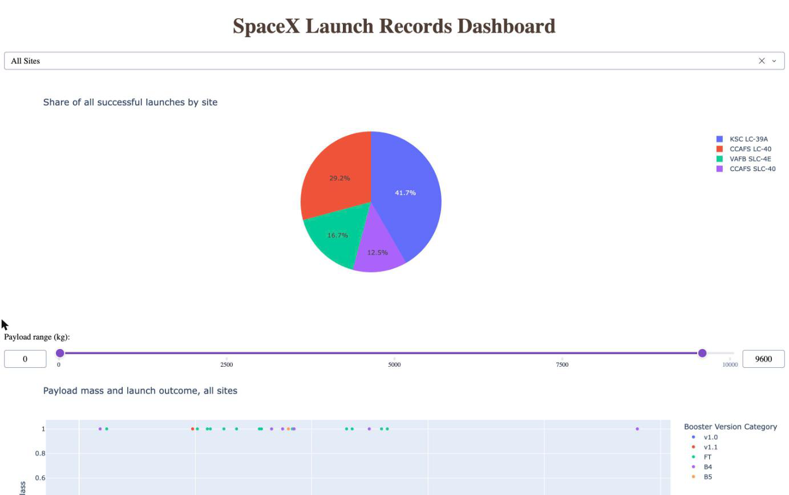

# SpaceX Falcon 9 First Stage Landing Prediction

This project predicts whether a SpaceX Falcon 9 first stage will land after launch. A landed first stage can be reused, which is the main reason a SpaceX launch costs much less than a competitor's, so a landing prediction helps estimate the cost of a launch. I collected launch data from the SpaceX API and Wikipedia, cleaned it, explored it with SQL, charts, maps and a Plotly Dash dashboard, and then trained four classification models. This was the capstone project of the IBM Data Science Professional Certificate (Applied Data Science Capstone).

| Finding | Result |
|---|---|
| Launches studied | 90 Falcon 9 launches from June 2010 to November 2020; 66.7% of first stages landed |
| Trend over time | The landing success rate rose from 0% in 2010 to 2013 to 90% in 2019 |
| By orbit | ES-L1, GEO, HEO and SSO orbits had a 100% success rate (1 to 5 launches each); GTO had the lowest of the common orbits, at 52% |
| By launch site | KSC LC-39A had the most successful launches (41.7% of all successes) and the highest success rate (76.9%, 10 of 13 launches) |
| First ground-pad landing | 22 December 2015 |
| Best models | Support vector machine, k-nearest neighbors and logistic regression all scored 83.3% on the test set (15 of 18 launches) and about 85% in 10-fold cross-validation. The decision tree scored 77.8% |

## Topics Covered

- Collecting data from a REST API and by web scraping HTML tables
- Data wrangling: missing values, filtering and creating a training label
- Exploratory data analysis with SQL (SQLite)
- Exploratory data analysis with charts
- Interactive maps of the launch sites, with distances to the coast and nearby cities
- An interactive dashboard with a dropdown, a range slider and linked charts
- Feature engineering with one-hot encoding and standardization
- Classification with logistic regression, a support vector machine, a decision tree and k-nearest neighbors
- Hyperparameter tuning with a grid search and 10-fold cross-validation, and evaluation with a test set and confusion matrices

## Python Libraries Used

- `requests`: calling the SpaceX API and downloading the Wikipedia page
- `BeautifulSoup` (`beautifulsoup4`): parsing the HTML launch tables
- `pandas` and `NumPy`: cleaning and analysis
- `sqlite3`: SQL queries
- `matplotlib` and `seaborn`: charts
- `folium`: interactive maps
- `plotly` and `dash`: the dashboard
- `scikit-learn`: the models, `GridSearchCV`, `StandardScaler` and `train_test_split`

Files:
- `notebooks/1_data_collection_api.ipynb`: Collecting launch data from the SpaceX API
- `notebooks/2_data_collection_webscraping.ipynb`: Scraping the launch tables from Wikipedia
- `notebooks/3_data_wrangling.ipynb`: Cleaning the data and creating the landing label
- `notebooks/4_eda_sql.ipynb`: Ten SQL queries about the launch records
- `notebooks/5_eda_visualization.ipynb`: Charts of the features against landing success, and feature engineering
- `notebooks/6_launch_site_map.ipynb`: Folium maps of the launch sites and their outcomes
- `notebooks/7_machine_learning_prediction.ipynb`: Training, tuning and comparing the four models
- `dashboard/spacex_dash_app.py`: The Plotly Dash dashboard. Run `python dashboard/spacex_dash_app.py` and open http://127.0.0.1:8050
- `dashboard/screenshots/`: Screenshots of the dashboard
- `maps/`: The three Folium maps as HTML files. GitHub cannot show interactive maps, so download a file and open it in a browser
- `data/`: The CSV files that the notebooks write
- `run_all.sh`: Runs every notebook in order