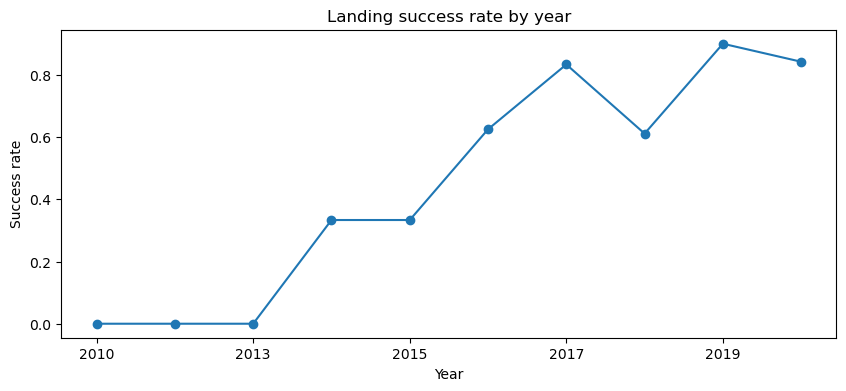
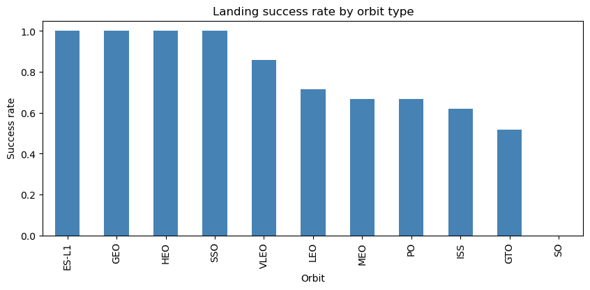
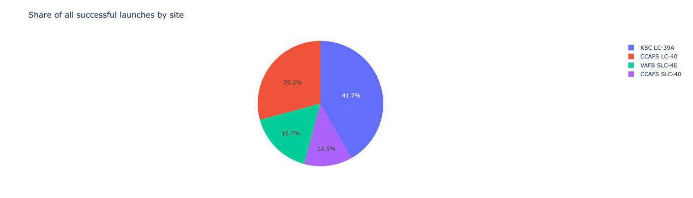
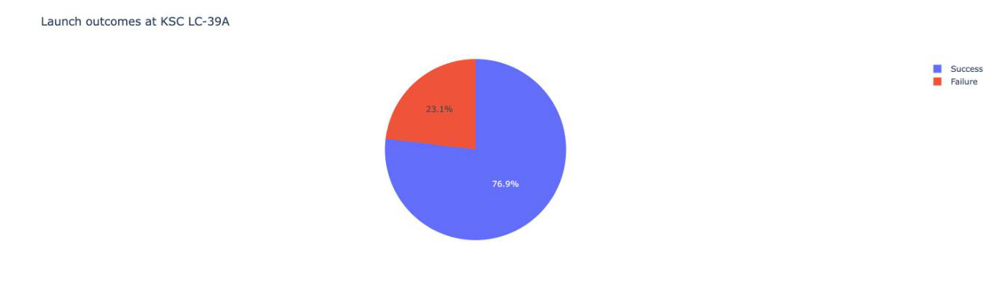
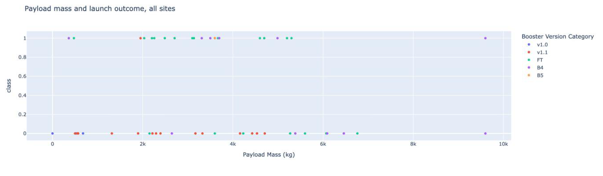
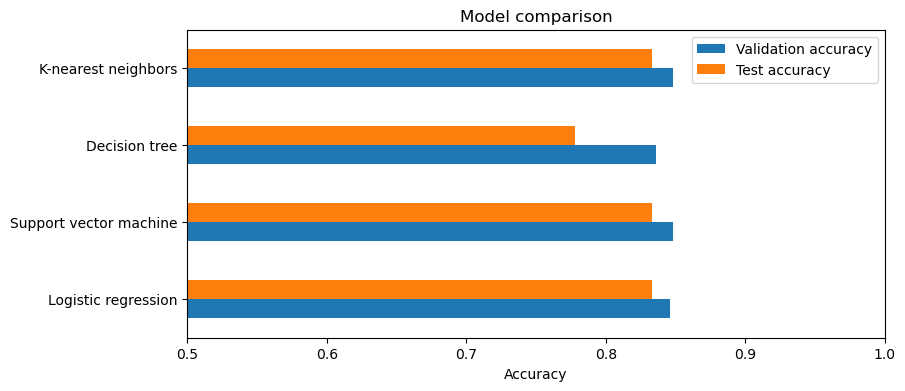
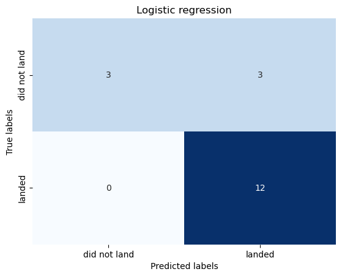

# Summary

A Falcon 9 launch is much cheaper than a competitor's launch mainly because SpaceX reuses the first stage. If we can predict whether the first stage will land, we can estimate the cost of a launch. This project collects SpaceX launch data, explores it, and trains four classification models to predict the landing.

- **Data:** 90 Falcon 9 launches from June 2010 to November 2020. 66.7% of the first stages landed.
- **Trend:** the landing success rate rose from 0% in 2010 to 2013 to 90% in 2019.
- **Launch site:** KSC LC-39A has the most successful launches (41.7% of all successes) and the highest success rate (76.9%).
- **Model:** a support vector machine, k-nearest neighbors and logistic regression all predicted 83.3% of the test launches correctly (15 of 18). Each model found all 12 landings, but it also predicted a landing for 3 of the 6 launches that did not land.

# Methodology

1. **Data collection.** Launch records came from the SpaceX REST API and from the Wikipedia list of Falcon 9 launches (web scraping with BeautifulSoup). The public SpaceX API was offline in November 2026, so the API notebook uses IBM's saved copy of the API result.
2. **Data wrangling.** Each landing outcome became a label, `Class`: 1 if the first stage landed and 0 if it did not. A missing payload mass was replaced with the mean.
3. **Exploratory analysis** with SQL queries, charts, an interactive Folium map and a Plotly Dash dashboard.
4. **Feature engineering.** Categorical features (orbit, launch site, landing pad and core serial) became one-hot columns, which gave 83 features. The features were then standardized.
5. **Models.** Logistic regression, a support vector machine, a decision tree and k-nearest neighbors were each tuned with a grid search and 10-fold cross-validation on 72 launches, then tested on 18 held-out launches.

# Exploratory Data Analysis

## SQL

| Question | Answer |
|---|---|
| Launch sites | CCAFS LC-40, CCAFS SLC-40, KSC LC-39A and VAFB SLC-4E |
| Total payload carried for NASA (CRS) | 45,596 kg |
| Average payload of booster version F9 v1.1 | 2,928.4 kg |
| First successful landing on a ground pad | 22 December 2015 |
| Most common landing outcome, June 2010 to March 2017 | No attempt (10 launches) |

## Landing success over time

{width=85%}

The success rate has risen steadily since 2013, as SpaceX improved the rocket and the landing method.

## Flight number and launch site

A scatter plot of flight number against launch site (notebook 5) shows that later flights land more often at every site. Experience matters more than the site itself.

## Success rate by orbit

{width=85%}

The ES-L1, GEO, HEO and SSO orbits had a 100% success rate, but with only 1 to 5 launches each. GTO, a common orbit for heavy commercial satellites, had a success rate of only 52%.

# Interactive Analysis

## Launch site map (Folium)

All launch sites are on a coast, so rockets fly over the ocean. CCAFS SLC-40 is 0.51 km from the coastline but 23.19 km from Titusville and 53.43 km from Melbourne, the nearest cities. The interactive maps are in the `maps/` folder of the repository.

## Dashboard (Plotly Dash)

{width=90%}

KSC LC-39A has the largest share of successful launches, 41.7%.

{width=90%}

KSC LC-39A has the highest success rate, 76.9% (10 of 13 launches).

{width=90%}

The FT booster version has the most successful launches across payload masses.

# Predictive Analysis

| Model | Validation accuracy (10-fold) | Test accuracy |
|---|---|---|
| Support vector machine | 0.848 | 0.833 |
| K-nearest neighbors | 0.848 | 0.833 |
| Logistic regression | 0.846 | 0.833 |
| Decision tree | 0.836 | 0.778 |

{width=75%}

{width=42%}

Three models tie on the test set, so the test set alone cannot choose between them: it has only 18 launches. Each of the three found all 12 landings but predicted a landing for 3 of the 6 launches that did not land. These false positives are the main weakness, because a cost estimate based on them would assume that a stage can be reused when it cannot.

# Conclusions

- Landing success improved a lot over time, so the flight number is a strong predictor.
- KSC LC-39A is the most successful launch site.
- The ES-L1, GEO, HEO and SSO orbits had the highest success rates, but they had few launches.
- A tuned classifier predicts the landing correctly about 83% of the time. A larger test set, or repeated cross-validation, is needed to choose one model over another.
